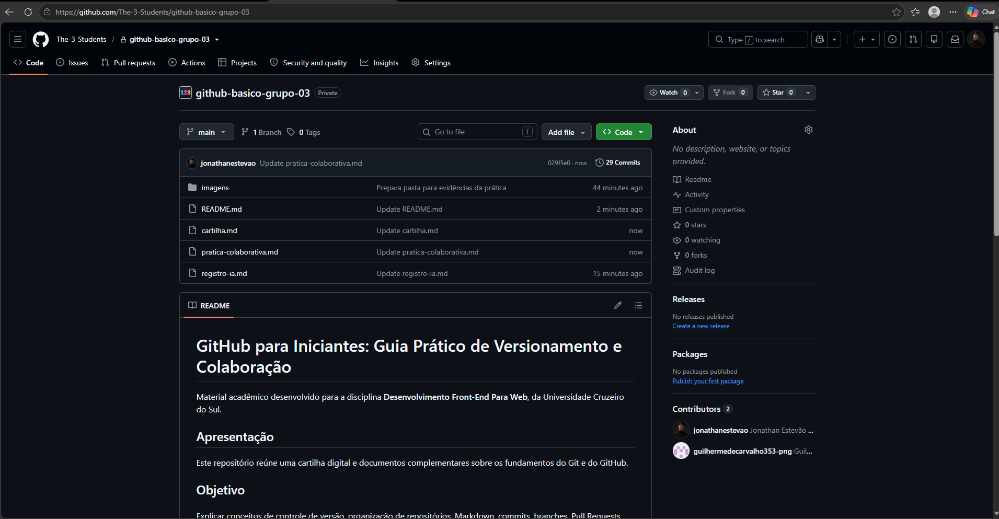

# GitHub para Iniciantes: Guia Prático de Versionamento e Colaboração

> **Material didático — Desenvolvimento Front-End Para Web**  
> Universidade Cruzeiro do Sul  
> **Grupo:** 03  
> **Integrantes:** [NOME COMPLETO — USUÁRIO GITHUB], [NOME COMPLETO — USUÁRIO GITHUB]  
> **Repositório:** [INSERIR URL DO REPOSITÓRIO]

---

## Sumário

1. [Apresentação](#1-apresentação)
2. [Introdução ao Git e GitHub](#2-introdução-ao-git-e-github)
3. [Conhecendo os repositórios](#3-conhecendo-os-repositórios)
4. [Primeiros passos no GitHub](#4-primeiros-passos-no-github)
5. [Trabalhando com arquivos e versões](#5-trabalhando-com-arquivos-e-versões)
6. [Colaboração entre integrantes](#6-colaboração-entre-integrantes)
7. [Prática orientada](#7-prática-orientada)
8. [Desafio final](#8-desafio-final)
9. [Dificuldades e soluções](#9-dificuldades-e-soluções)
10. [Considerações finais](#10-considerações-finais)
11. [Referências](#11-referências)

---

## 1. Apresentação

### GitHub para Iniciantes: Guia Prático de Versionamento e Colaboração

**Instituição:** Universidade Cruzeiro do Sul  
**Curso:** Análise e Desenvolvimento de Sistemas  
**Disciplina:** Desenvolvimento Front-End Para Web  
**Grupo:** [NÚMERO DO GRUPO]  
**Integrantes:**
- [NOME COMPLETO — USUÁRIO GITHUB]
- [NOME COMPLETO — USUÁRIO GITHUB]
- [ADICIONE OU REMOVA LINHAS CONFORME A COMPOSIÇÃO DO GRUPO]

### Público-alvo

Estudantes e pessoas que estão começando a estudar desenvolvimento de software e ainda não possuem experiência com Git ou GitHub.

### Objetivo

Apresentar os conceitos fundamentais de versionamento e ensinar, por meio de instruções práticas, como organizar arquivos, registrar alterações e colaborar em projetos utilizando a interface web do GitHub.

### Conhecimentos necessários

Não é necessário saber programar nem conhecer comandos de terminal. É suficiente ter acesso à internet, um navegador atualizado e uma conta no GitHub. Os procedimentos deste material foram planejados para serem realizados pelo navegador.

> **Nota sobre as evidências:** este guia apresenta procedimentos para reprodução. As capturas de tela e os resultados da atividade do grupo devem ser inseridos somente depois que os integrantes executarem os passos. Nenhum exemplo deste documento deve ser interpretado como comprovação de que um teste foi realizado.

## 2. Introdução ao Git e GitHub

### 2.1 O que é Git?

Git é um sistema distribuído de controle de versão. Ele registra alterações feitas em arquivos ao longo do tempo e permite consultar versões anteriores, comparar mudanças e desenvolver diferentes partes de um projeto sem precisar manter várias cópias manuais de cada arquivo.

O termo **distribuído** significa que cada cópia completa de um repositório Git pode armazenar seu próprio histórico. O Git pode ser utilizado localmente, mesmo sem o GitHub ou uma conexão constante com a internet.

### 2.2 O que é GitHub?

GitHub é uma plataforma online que hospeda repositórios Git e oferece recursos para compartilhar projetos, organizar tarefas, discutir alterações e colaborar com outras pessoas. Entre seus recursos estão repositórios, branches, commits, issues e pull requests.

Em termos simples: o Git é a ferramenta de controle de versão; o GitHub é uma plataforma que hospeda repositórios Git e oferece recursos de colaboração.

### 2.3 Diferença entre Git e GitHub

| Git | GitHub |
|---|---|
| É um sistema de controle de versão. | É uma plataforma de hospedagem e colaboração. |
| Pode funcionar no computador sem internet. | É acessado pela internet, principalmente pelo navegador. |
| Registra alterações e histórico. | Armazena repositórios Git e oferece ferramentas colaborativas. |
| Pode ser utilizado por terminal ou aplicativos gráficos. | Permite visualizar e editar arquivos, revisar e integrar alterações pela web. |

### 2.4 Para que são utilizados?

No desenvolvimento de software, Git e GitHub ajudam a:
- acompanhar a evolução de arquivos de código;
- identificar quem realizou determinada contribuição;
- recuperar ou comparar versões anteriores;
- desenvolver funcionalidades separadamente;
- revisar alterações antes de incorporá-las ao projeto;
- compartilhar o trabalho com colegas e comunidades.

Esses recursos também podem ser usados em trabalhos acadêmicos, documentação, anotações, materiais de estudo e projetos que não sejam exclusivamente de programação.

### 2.5 Por que o controle de versão é importante?

Imagine que uma equipe esteja escrevendo um site e alguém apague acidentalmente uma parte importante do código. Sem histórico de versões, recuperar o conteúdo pode ser difícil. Com controle de versão, a equipe consegue consultar as alterações anteriores e entender como o arquivo chegou ao estado atual.

O controle de versão não substitui cópias de segurança nem elimina todos os erros, mas oferece rastreabilidade e facilita a recuperação e a colaboração.

## 3. Conhecendo os repositórios

### 3.1 O que é um repositório?

Um **repositório** (repository) é o espaço onde ficam armazenados os arquivos de um projeto e o histórico de alterações acompanhado pelo Git. Ele pode conter códigos, documentos, imagens, pastas e outros materiais.

No GitHub, a página inicial de um repositório apresenta informações como nome, descrição, arquivos, branches e histórico de atividade, conforme as permissões de acesso.

### 3.2 Repositórios públicos e privados

| Público | Privado |
|---|---|
| Pode ser visualizado por qualquer pessoa na internet. | O conteúdo fica restrito às pessoas autorizadas. |
| É adequado para portfólios, projetos abertos e materiais que podem ser divulgados. | É adequado para trabalhos ou projetos que precisam de acesso limitado. |
| Qualquer pessoa pode consultar o conteúdo, mas somente pessoas com permissão podem contribuir diretamente. | Somente pessoas autorizadas podem visualizar e colaborar. |

**Atenção:** tornar um repositório público significa divulgar também os arquivos e o histórico que estiverem disponíveis nele. Antes de publicar, confira se não há senhas, tokens, chaves de API, dados pessoais, documentos particulares ou informações que não deveriam ser compartilhadas. Apagar um arquivo em uma alteração posterior não garante que o conteúdo deixe de existir no histórico.

A visibilidade pode ser alterada nas configurações do repositório, mas essa decisão deve considerar as regras da instituição e a autorização de todos os envolvidos.

### 3.3 Como criar um repositório pelo navegador

Se o repositório do grupo já existe, esta seção serve como referência para criar projetos futuros.

1. Acesse [github.com](https://github.com/) e entre na sua conta.
2. No canto superior direito, abra o menu de criação e escolha **New repository** (Novo repositório). Também é possível acessar diretamente [github.com/new](https://github.com/new).
3. Em **Repository name**, informe um nome curto e descritivo, por exemplo `meus-estudos`.
4. Se desejar, preencha a descrição.
5. Escolha **Public** (público) ou **Private** (privado).
6. Se for um projeto novo, marque a opção para adicionar um arquivo README.
7. Confira as opções e selecione **Create repository** (Criar repositório).

**Resultado esperado:** a página do novo repositório será aberta e exibirá o README inicial, caso essa opção tenha sido selecionada.

> **ESPAÇO RESERVADO PARA A CAPTURA 01 — CRIAÇÃO DO REPOSITÓRIO**
>
> **[INSERIR A PRINT REAL AQUI]**
>
> Arquivo: `imagens/01-criacao-repositorio.png`
>
> O que mostrar: a página do repositório do grupo, com o nome e a estrutura inicial visíveis.
>
> Legenda sugerida: *Figura 1 — Criação do repositório do grupo no GitHub.*
>
> Depois de enviar a imagem para a pasta `imagens/`, substitua este bloco pelo recurso:
>
> ``

### 3.4 Organização dos arquivos

Uma estrutura simples ajuda outras pessoas a entenderem o projeto. Para esta atividade, recomenda-se:

```text
github-basico-grupo-XX/
├── README.md
├── cartilha.md
├── pratica-colaborativa.md
├── registro-ia.md
└── imagens/
    ├── 01-criacao-repositorio.png
    ├── 02-arquivo-compartilhado.png
    ├── 03-historico-commits.png
    ├── 04-pull-request.png
    └── 05-resultado-merge.png
```

Os nomes acima são os nomes planejados para os arquivos. As imagens devem ser adicionadas depois que as capturas reais forem produzidas.

## 4. Primeiros passos no GitHub

### 4.1 Criar ou acessar uma conta

1. Acesse [github.com](https://github.com/).
2. Se ainda não tiver uma conta, escolha a opção de cadastro e siga as etapas indicadas pela plataforma.
3. Utilize um endereço de e-mail ao qual tenha acesso.
4. Conclua as verificações solicitadas pelo GitHub.
5. Se já tiver uma conta, selecione **Sign in** (Entrar) e informe suas credenciais.

Nunca compartilhe sua senha ou códigos de autenticação com colegas. Cada integrante deve utilizar sua própria conta.

### 4.2 Conhecer a página inicial

Após entrar, o usuário poderá acessar seus repositórios, acompanhar atividades e utilizar os menus de navegação. A aparência pode mudar conforme atualizações da plataforma e idioma escolhido.

Para abrir um repositório, selecione-o na lista de repositórios ou acesse seu endereço.

### 4.3 Criar e editar um README.md

O arquivo `README.md` apresenta informações essenciais sobre o projeto. O GitHub normalmente exibe o README da raiz do repositório abaixo da lista de arquivos.

Para criar um README em um repositório que ainda não possui um:
1. Abra a página principal do repositório.
2. Selecione **Add file** (Adicionar arquivo) e depois **Create new file** (Criar novo arquivo).
3. No campo do nome, digite `README.md`.
4. Escreva uma apresentação do projeto.
5. Selecione **Commit changes** (Confirmar alterações), informe uma mensagem e confirme.

Para editar um README existente:
1. Abra o arquivo `README.md`.
2. Selecione o ícone de edição (lápis), quando disponível.
3. Faça as alterações no editor.
4. Revise a pré-visualização, se disponível.
5. Selecione **Commit changes** e registre uma mensagem clara.

### 4.4 O que é Markdown?

Markdown é uma linguagem leve de marcação usada para formatar texto com caracteres simples. No GitHub, ela é utilizada em arquivos `.md`, descrições, comentários, issues e pull requests.

A versão utilizada pelo GitHub inclui recursos próprios, conhecida como GitHub Flavored Markdown. A seguir estão exemplos básicos que podem ser copiados.

**Títulos e subtítulos**

```markdown
# Título principal
## Seção
### Subseção
```

**Negrito e itálico**

```markdown
**Texto em negrito**
*Texto em itálico*
```

**Listas**

```markdown
- Primeiro item
- Segundo item
  - Subitem

1. Primeiro passo
2. Segundo passo
3. Terceiro passo
```

**Lista de tarefas**

```markdown
- [x] Criar o repositório
- [ ] Escrever o README
- [ ] Revisar o conteúdo
```

**Links**

```markdown
[Documentação oficial do GitHub](https://docs.github.com/pt)
```

**Imagens**

```markdown

```

O texto entre colchetes é uma descrição alternativa da imagem. O caminho deve corresponder exatamente à localização e ao nome do arquivo.

**Tabelas**

```markdown
| Recurso | Finalidade |
|---|---|
| Git | Controle de versão |
| GitHub | Hospedagem e colaboração |
```

**Blocos de código**

Use três crases antes e depois do trecho. É possível indicar a linguagem para destacar a sintaxe:

````markdown
```python
print("Olá, mundo!")
```
````

### 4.5 Como organizar um README profissional

Um README útil deve responder rapidamente:
- Qual é o nome do projeto?
- Qual é seu objetivo?
- O que o repositório contém?
- Quem participou?
- Como navegar pela documentação?
- Quais fontes ou recursos foram utilizados?

Evite parágrafos muito longos, informações desnecessárias e links sem descrição. Mantenha os dados atualizados e não inclua credenciais ou informações pessoais sensíveis.

## 5. Trabalhando com arquivos e versões

### 5.1 Criar um arquivo pelo navegador

1. Abra o repositório.
2. Clique em **Add file** e depois em **Create new file**.
3. Informe o nome e, se necessário, o caminho. Por exemplo, `anotacoes.md` ou `estudos/anotacoes.md`.
4. Digite o conteúdo.
5. Selecione **Commit changes**.
6. Escreva uma mensagem que explique a criação do arquivo.
7. Confirme o commit.

Se o caminho incluir uma pasta que ainda não existe, o GitHub poderá criá-la ao salvar o arquivo.

### 5.2 Enviar arquivos existentes

1. Abra a página principal do repositório.
2. Selecione **Add file** e depois **Upload files** (Enviar arquivos).
3. Arraste os arquivos para a área indicada ou utilize o seletor do computador.
4. Confira os nomes e a lista de arquivos selecionados.
5. Informe uma mensagem de commit.
6. Selecione **Commit changes**.

Antes do envio, verifique se os arquivos não contêm dados sigilosos e se os formatos e tamanhos são adequados ao GitHub.

### 5.3 Editar um arquivo

1. Abra o arquivo que deseja modificar.
2. Clique no ícone de lápis, se a edição pela web estiver disponível.
3. Faça a alteração.
4. Confira se o conteúdo não foi apagado ou substituído indevidamente.
5. Registre a alteração em **Commit changes**.

Em um repositório colaborativo, verifique se outra pessoa está editando o mesmo arquivo. Combine previamente quem ficará responsável por cada parte.

### 5.4 O que é um commit?

Um **commit** é um registro de alterações em um ou mais arquivos de uma branch. Cada commit possui um identificador único (hash ou SHA), informações de autoria, data e uma mensagem que descreve a mudança.

Uma comparação simples é pensar no commit como um ponto registrado no histórico do projeto. Ele não é apenas um botão de salvar: é uma confirmação de um conjunto de alterações no histórico do Git.

### 5.5 Como registrar um commit pelo navegador

Ao criar ou editar um arquivo pela interface web:
1. Localize a seção **Commit changes** ao final do editor.
2. No campo de mensagem, escreva um resumo objetivo.
3. Se necessário, acrescente uma descrição complementar.
4. Escolha se a alteração será registrada diretamente na branch atual ou em uma nova branch, conforme as opções exibidas.
5. Confirme em **Commit changes**.

A interface e as opções disponíveis podem variar conforme a tela, permissões e estado do repositório.

### 5.6 Como escrever mensagens claras

Uma boa mensagem informa o que foi alterado, sem ser vaga.

| Mensagem vaga | Mensagem mais clara |
|---|---|
| `mudanças` | `Adiciona seção sobre repositórios privados` |
| `arquivo` | `Cria anotações iniciais de Git` |
| `corrigido` | `Corrige links da documentação oficial` |
| `teste` | `Inclui exemplo de tabela em Markdown` |

Prefira mensagens curtas, específicas e coerentes com o conteúdo do commit. Não registre uma mensagem que descreva algo que não foi alterado.

### 5.7 Consultar o histórico e identificar autores

1. Abra a página principal do repositório.
2. Acesse a área de histórico de commits, geralmente disponível pelo link de commits próximo à lista de arquivos ou pelo histórico da branch.
3. Selecione um commit para visualizar seus detalhes.
4. Observe a mensagem, o autor, a data e os arquivos alterados.
5. Quando disponível, abra a comparação de alterações para verificar o que foi adicionado ou removido.

O histórico permite acompanhar a evolução do projeto. A autoria exibida depende dos dados associados ao commit e da configuração da conta. Não confunda o autor do commit com a pessoa que apenas revisou um Pull Request.

> **ESPAÇO RESERVADO PARA A CAPTURA 03 — HISTÓRICO DE COMMITS**
>
> **[INSERIR A PRINT REAL AQUI]**
>
> Arquivo: `imagens/03-historico-commits.png`
>
> O que mostrar: a lista de commits com mensagens, datas e autores das contribuições dos integrantes.
>
> Legenda sugerida: *Figura 3 — Histórico de commits e identificação das contribuições.*
>
> Depois de enviar a imagem para a pasta `imagens/`, substitua este bloco pelo recurso:
>
> ``

## 6. Colaboração entre integrantes

### 6.1 Convidar colaboradores

Em um repositório pessoal, quem possui permissão de proprietário pode convidar outras contas para colaborar.

1. Abra a página principal do repositório.
2. Entre em **Settings** (Configurações).
3. Na área de acesso, abra **Collaborators** (Colaboradores) ou a opção equivalente apresentada.
4. Selecione **Add people** (Adicionar pessoas).
5. Pesquise pelo nome de usuário do GitHub da pessoa.
6. Selecione a conta correta e envie o convite.
7. O convidado deverá aceitar o convite para obter acesso.

Os nomes e a posição dos menus podem variar. Se o repositório pertencer a uma organização, as regras de acesso podem ser diferentes.

### 6.2 Aceitar um convite

1. Abra a notificação ou o e-mail enviado pelo GitHub.
2. Acesse o convite correspondente.
3. Confira se o repositório e o proprietário estão corretos.
4. Selecione a opção para aceitar.
5. Abra o repositório e verifique se o acesso foi concedido.

Um convite pendente ainda não significa que a pessoa já tenha aceitado ou esteja apta a editar.

### 6.3 Compartilhar um repositório

Para compartilhar, copie o endereço da página do repositório e envie aos integrantes. O link permite acessar a página, mas não concede permissões por si só. Em repositórios privados, a pessoa precisa estar autorizada.

### 6.4 O que é uma branch?

Uma **branch** (ramificação) é uma linha independente de desenvolvimento dentro do mesmo repositório. Ela permite trabalhar em alterações sem modificar imediatamente a branch principal.

A branch padrão costuma se chamar `main`, mas o nome pode variar. Ela é a referência principal configurada para o repositório.

Exemplo:

```text
main
 ├── conteudo-readme
 ├── exemplo-markdown
 └── correcao-documentacao
```

As branches secundárias podem ser usadas para desenvolver partes específicas e depois propor a integração das alterações.

### 6.5 Criar uma branch pelo navegador

1. Abra a página principal do repositório.
2. Localize o seletor de branch, que normalmente exibe `main` ou o nome da branch atual.
3. Abra o seletor e digite um nome novo, como `exemplo-markdown`.
4. Se a opção aparecer, escolha criar a branch a partir da branch principal.
5. Confirme a criação.

O GitHub abrirá a nova branch. Confira o nome exibido no seletor antes de editar qualquer arquivo.

### 6.6 Editar arquivos dentro de uma branch

1. Confirme que a branch secundária está selecionada.
2. Abra ou crie o arquivo que será alterado.
3. Faça a edição.
4. Ao registrar o commit, confira se ele será salvo na branch secundária.
5. Confirme a alteração e verifique se o commit aparece no histórico dessa branch.

Essa conferência evita registrar acidentalmente a alteração diretamente na branch principal.

### 6.7 O que é um Pull Request?

Um **Pull Request (PR)**, ou solicitação de pull, é uma proposta para incorporar alterações de uma branch em outra. Ele cria um espaço para apresentar, discutir e revisar as mudanças antes da integração.

Um Pull Request não realiza automaticamente o Merge. Primeiro, a equipe pode examinar os arquivos alterados, consultar commits, comentar trechos e solicitar correções.

### 6.8 Como abrir um Pull Request

1. Faça pelo menos um commit na branch secundária.
2. Abra a área **Pull requests** do repositório.
3. Selecione **New pull request**.
4. Escolha a branch de destino (base), normalmente `main`.
5. Escolha a branch que contém as alterações (compare).
6. Confira a comparação apresentada.
7. Selecione **Create pull request**.
8. Informe um título objetivo e descreva o que foi alterado.
9. Confirme a abertura.

Se o GitHub exibir um aviso para comparar e abrir um Pull Request após o commit, essa opção também pode ser utilizada.

> **ESPAÇO RESERVADO PARA A CAPTURA 04 — PULL REQUEST ABERTO**
>
> **[INSERIR A PRINT REAL AQUI]**
>
> Arquivo: `imagens/04-pull-request.png`
>
> O que mostrar: a página do Pull Request aberto, com título, branches base e de comparação e estado da solicitação.
>
> Legenda sugerida: *Figura 4 — Pull Request aberto para revisão das alterações.*
>
> Depois de enviar a imagem para a pasta `imagens/`, substitua este bloco pelo recurso:
>
> ``

### 6.9 Revisar alterações e solicitar correções

1. Abra o Pull Request.
2. Leia a descrição e confira a branch de origem e a branch de destino.
3. Acesse **Files changed** (Arquivos alterados).
4. Leia as mudanças e verifique se correspondem ao objetivo informado.
5. Utilize os comentários para apontar dúvidas ou sugerir melhorias.
6. Se necessário, solicite alterações pela opção de revisão disponível.
7. O autor poderá corrigir a branch de origem; os novos commits serão refletidos no Pull Request.

Uma revisão deve ser respeitosa, específica e relacionada ao trabalho. Exemplo: “O link desta seção aponta para a página inicial; poderia ser atualizado para a documentação de commits?”.

### 6.10 O que é Merge?

**Merge** (mesclagem ou integração) é a operação que incorpora alterações de uma branch em outra. No fluxo de Pull Request, o Merge integra as mudanças propostas à branch de destino, desde que as permissões e regras do repositório permitam.

### 6.11 Como realizar o Merge

1. Abra o Pull Request.
2. Confirme que a branch base está correta.
3. Confira os arquivos alterados e os comentários da revisão.
4. Verifique se há conflitos, revisões obrigatórias ou verificações pendentes.
5. Quando o GitHub permitir, selecione a opção **Merge pull request** ou o método de mesclagem disponibilizado.
6. Confirme em **Confirm merge**.
7. Retorne à branch principal e confira se as alterações foram incorporadas.

O GitHub pode oferecer diferentes métodos de mesclagem, como merge commit, squash e rebase. Para um exercício introdutório, utilize a opção padrão disponível no repositório e registre qual foi utilizada.

> **ESPAÇO RESERVADO PARA A CAPTURA 05 — RESULTADO DO MERGE**
>
> **[INSERIR A PRINT REAL AQUI]**
>
> Arquivo: `imagens/05-resultado-merge.png`
>
> O que mostrar: o Pull Request marcado como merged e, se possível, o arquivo atualizado na branch principal.
>
> Legenda sugerida: *Figura 5 — Alterações incorporadas à branch principal após o Merge.*
>
> Depois de enviar a imagem para a pasta `imagens/`, substitua este bloco pelo recurso:
>
> ``

### 6.12 Como evitar conflitos e perda de alterações

Um conflito pode ocorrer quando alterações incompatíveis são feitas na mesma parte de um arquivo e o Git não consegue combiná-las automaticamente.

Boas práticas:
- combinar previamente quem editará cada arquivo;
- dividir o trabalho em partes pequenas;
- usar branches para alterações independentes;
- escrever mensagens de commit claras;
- revisar a branch de destino antes de integrar alterações;
- ler os avisos do GitHub antes de confirmar uma mesclagem;
- não sobrescrever o conteúdo de colegas sem conversar;
- manter cópias de segurança de materiais importantes quando apropriado.

O uso de branches e Pull Requests reduz riscos, mas não impede todos os conflitos.

## 7. Prática orientada

Os exercícios a seguir foram elaborados para serem executados pelo navegador. O grupo deve realizar os passos e registrar os resultados verdadeiros. Os resultados descritos são expectativas, não afirmações de que os testes já foram concluídos.

### Exercício 1 — Acessar o repositório do grupo

**Objetivo:** confirmar que cada integrante consegue abrir o repositório.

**Procedimentos:**
1. Abra o link do repositório enviado pelo responsável.
2. Entre na sua própria conta GitHub.
3. Se o repositório for privado, confira se o convite foi aceito.
4. Abra a página inicial e identifique os arquivos disponíveis.

**Resultado esperado:** o integrante consegue visualizar o repositório e seus arquivos.

**Como verificar:** confirme que o nome do repositório aparece no topo e que a lista de arquivos está visível.

**Registro do grupo:** [PREENCHER APÓS A EXECUÇÃO.]

### Exercício 2 — Criar e editar um arquivo

**Objetivo:** praticar a criação e edição de arquivos pela interface web.

**Procedimentos:**
1. Abra o repositório.
2. Selecione **Add file** e **Create new file**.
3. Crie `anotacoes-colaborativas.md`.
4. Escreva um pequeno texto sobre o que aprendeu nesta atividade.
5. Registre a alteração com a mensagem `Cria arquivo de anotações colaborativas`.
6. Abra o arquivo e confira o conteúdo.

**Resultado esperado:** o arquivo aparece na lista do repositório e contém o texto inserido.

**Como verificar:** abra o arquivo e confira o conteúdo e o commit correspondente no histórico.

**Registro do grupo:** [PREENCHER APÓS A EXECUÇÃO.]

> **ESPAÇO RESERVADO PARA A CAPTURA 02 — ARQUIVO COMPARTILHADO E EDITADO**
>
> **[INSERIR A PRINT REAL AQUI]**
>
> Arquivo: `imagens/02-arquivo-compartilhado.png`
>
> O que mostrar: o arquivo coletivo aberto no GitHub, mostrando a dica acrescentada por um integrante e, quando possível, o nome da conta usada na contribuição.
>
> Legenda sugerida: *Figura 2 — Edição do arquivo compartilhado por um integrante.*
>
> Depois de enviar a imagem para a pasta `imagens/`, substitua este bloco pelo recurso:
>
> ``

### Exercício 3 — Criar uma branch e registrar um commit

**Objetivo:** compreender como trabalhar em uma ramificação independente.

**Procedimentos:**
1. Abra o seletor de branches.
2. Crie uma branch chamada `atividade-colaborativa`.
3. Confirme que ela está selecionada.
4. Edite `anotacoes-colaborativas.md` e adicione uma nova seção.
5. Registre a alteração com a mensagem `Adiciona seção de aprendizado colaborativo`.
6. Consulte o histórico da branch.

**Resultado esperado:** a alteração aparece na branch `atividade-colaborativa`, sem ser incorporada ainda à branch principal.

**Como verificar:** confira o seletor de branch e localize o commit no histórico da branch.

**Registro do grupo:** [PREENCHER APÓS A EXECUÇÃO.]

### Exercício 4 — Abrir e revisar um Pull Request

**Objetivo:** propor uma alteração e permitir que outro integrante a revise.

**Procedimentos:**
1. Com a branch secundária atualizada, abra **Pull requests**.
2. Selecione **New pull request**.
3. Defina `main` como branch base e `atividade-colaborativa` como branch de comparação.
4. Confira a lista de alterações.
5. Crie o Pull Request com título e descrição objetivos.
6. Peça a outro integrante que revise a proposta.
7. O revisor deve examinar **Files changed** e registrar um comentário pertinente.

**Resultado esperado:** o Pull Request fica aberto e apresenta as alterações propostas e a discussão da revisão.

**Como verificar:** confira o título, as branches, a aba de arquivos alterados e os comentários.

**Registro do grupo:** [PREENCHER APÓS A EXECUÇÃO.]

### Exercício 5 — Realizar o Merge

**Objetivo:** incorporar uma alteração revisada à branch principal.

**Procedimentos:**
1. Abra o Pull Request revisado.
2. Confira se as alterações estão corretas.
3. Verifique se não existem bloqueios ou conflitos.
4. Se o GitHub permitir, selecione **Merge pull request**.
5. Confirme a mesclagem.
6. Abra a branch `main`.
7. Confira o arquivo alterado.

**Resultado esperado:** o Pull Request aparece como mesclado e a alteração está presente na branch principal.

**Como verificar:** consulte o estado do Pull Request e abra o arquivo na branch `main`.

**Registro do grupo:** [PREENCHER APÓS A EXECUÇÃO.]

### Evidências da prática

Insira as capturas reais na pasta `imagens/` e mantenha os nomes previstos:

1. **Criação do repositório:** deve mostrar o nome e a página inicial do repositório. Legenda: *Figura 1 — Repositório do grupo no GitHub.*
2. **Arquivo compartilhado:** deve mostrar o arquivo e a edição ou contribuição realizada. Legenda: *Figura 2 — Edição de arquivo pela interface web.*
3. **Histórico de commits:** deve mostrar mensagens, datas e autores disponíveis. Legenda: *Figura 3 — Histórico de alterações do repositório.*
4. **Pull Request:** deve mostrar o Pull Request aberto e as branches envolvidas. Legenda: *Figura 4 — Pull Request submetido para revisão.*
5. **Resultado do Merge:** deve mostrar o Pull Request mesclado e, preferencialmente, o conteúdo na branch principal. Legenda: *Figura 5 — Alteração incorporada à branch principal.*

Para inserir as imagens neste documento, utilize caminhos relativos, por exemplo:

```markdown

```

Antes de publicar, oculte e-mails, notificações particulares, dados de conta e qualquer informação sensível que não seja necessária para comprovar a atividade. Não edite a imagem de modo a alterar o sentido da evidência.

## 8. Desafio final

> **Desafio obrigatório:** "Crie um repositório de estudos, escreva um README com seu objetivo e três assuntos que deseja aprender, adicione um arquivo de anotações e registre uma alteração com um commit claro. Compartilhe o repositório com um colega e confira a contribuição dele."

### Como realizar

1. **Criar o repositório:** entre em [github.com/new](https://github.com/new), escolha um nome como `meus-estudos`, defina a visibilidade e crie o repositório com README.
2. **Escrever o objetivo:** abra o README e explique em poucas linhas para que o repositório será utilizado.
3. **Listar três assuntos:** registre três temas que deseja estudar. Exemplo: HTML, CSS e JavaScript.
4. **Adicionar anotações:** crie `anotacoes.md` e escreva um resumo inicial de um dos assuntos.
5. **Registrar um commit:** utilize uma mensagem clara, como `Adiciona anotações iniciais sobre HTML`.
6. **Compartilhar com um colega:** se o repositório for pessoal, convide o colega em **Settings > Collaborators**. Se for privado, ele precisará aceitar o convite. Um link sozinho não concede acesso.
7. **Conferir a contribuição:** peça ao colega para adicionar uma informação útil ao arquivo ou criar uma contribuição combinada. Depois, consulte o arquivo e o histórico para identificar a alteração e sua autoria.

### Modelo de README para o desafio

```markdown
# Meu espaço de estudos

## Objetivo
Utilizar este repositório para organizar meus estudos e acompanhar minha evolução em tecnologia.

## Assuntos que desejo aprender
1. HTML
2. CSS
3. JavaScript

## Arquivos
- `anotacoes.md`: registros e resumos dos estudos.

## Colaboração
Este repositório será utilizado para praticar colaboração e controle de versão com colegas.
```

### Lista de verificação

- [ ] Criei um repositório de estudos.
- [ ] Escrevi o objetivo no README.
- [ ] Listei três assuntos que desejo aprender.
- [ ] Adicionei um arquivo de anotações.
- [ ] Registrei uma alteração com uma mensagem clara de commit.
- [ ] Compartilhei o repositório com um colega.
- [ ] O colega aceitou o convite, se necessário.
- [ ] Conferi a contribuição do colega.
- [ ] Consultei o histórico para identificar a autoria.

## 9. Dificuldades e soluções

A tabela apresenta situações comuns que podem ocorrer com iniciantes. São possibilidades gerais, não dificuldades que o grupo necessariamente vivenciou.

| Dificuldade | Possível causa | Solução recomendada |
|---|---|---|
| Não consigo acessar um repositório privado. | O convite não foi aceito ou a conta não recebeu permissão. | Conferir a conta utilizada, localizar o convite e solicitar ao proprietário que verifique o acesso. |
| Não encontro o botão de edição. | Permissão insuficiente, arquivo não editável naquela tela ou interface diferente. | Conferir o acesso e abrir o arquivo diretamente na página do repositório. |
| A alteração foi salva na branch errada. | O seletor de branch não foi conferido antes do commit. | Verificar a branch selecionada antes de editar e confirmar onde o commit foi registrado. |
| O Pull Request não pode ser mesclado. | Pode haver conflito, revisão obrigatória ou verificação pendente. | Ler o aviso exibido pelo GitHub e resolver o requisito indicado com o responsável pelo repositório. |
| Não encontro o arquivo enviado. | O envio não foi confirmado ou ocorreu em outra branch ou pasta. | Conferir a mensagem de confirmação, a branch e o caminho do arquivo. |
| O Markdown aparece como texto sem formatação. | Sintaxe incorreta ou arquivo com extensão inadequada. | Conferir a extensão `.md`, os caracteres de formatação e a pré-visualização. |
| Dois integrantes alteraram a mesma parte do arquivo. | Falta de divisão de tarefas ou trabalho simultâneo. | Conversar, comparar as versões e combinar a resolução antes de integrar as alterações. |
| A imagem não aparece no README. | Caminho ou nome do arquivo incorreto, ou imagem não foi enviada. | Conferir letras maiúsculas/minúsculas, extensão e localização do arquivo. |

### Registro das dificuldades efetivamente encontradas pelo grupo

Preencher somente após a realização dos exercícios.

| Integrante | Dificuldade encontrada | Como foi resolvida | Evidência ou observação |
|---|---|---|---|
| [NOME] | [PREENCHER] | [PREENCHER] | [PREENCHER] |
| [NOME] | [PREENCHER] | [PREENCHER] | [PREENCHER] |
| [ADICIONE LINHAS SE NECESSÁRIO] | | | |

Se não houver dificuldade, registrar isso de forma verdadeira, por exemplo: “O integrante informou que concluiu a atividade sem encontrar dificuldades relevantes”.

## 10. Considerações finais

O Git e o GitHub são recursos importantes para estudantes e profissionais de tecnologia porque ajudam a organizar projetos, acompanhar alterações e colaborar de maneira estruturada. O controle de versão permite compreender a evolução de um trabalho, enquanto commits e branches tornam as contribuições mais rastreáveis e organizadas.

Pull Requests acrescentam uma etapa de discussão e revisão antes da integração das mudanças. Esse processo favorece a comunicação da equipe e ajuda a identificar problemas com antecedência.

Para estudantes, utilizar o GitHub também pode contribuir para a construção de um portfólio, reunindo projetos, exercícios, documentação e registros de aprendizado. Mais do que conhecer os botões da plataforma, é importante desenvolver hábitos de organização, clareza nas mensagens e respeito ao trabalho dos colegas.

## 11. Referências

As referências abaixo são páginas da documentação oficial do GitHub. Os procedimentos devem ser consultados novamente caso a interface seja atualizada.

1. GITHUB. **Hello World**. Disponível em: <https://docs.github.com/pt/get-started/using-github/hello-world>. Acesso em: 6 nov. 2026.
2. GITHUB. **Trabalhando com arquivos**. Disponível em: <https://docs.github.com/pt/repositories/working-with-files>. Acesso em: 6 nov. 2026.
3. GITHUB. **Sobre repositórios**. Disponível em: <https://docs.github.com/pt/repositories/creating-and-managing-repositories/about-repositories>. Acesso em: 6 nov. 2026.
4. GITHUB. **Criar um repositório**. Disponível em: <https://docs.github.com/pt/repositories/creating-and-managing-repositories/creating-a-new-repository>. Acesso em: 6 nov. 2026.
5. GITHUB. **Sobre o arquivo README do repositório**. Disponível em: <https://docs.github.com/pt/repositories/managing-your-repositorys-settings-and-features/customizing-your-repository/about-readmes>. Acesso em: 6 nov. 2026.
6. GITHUB. **Como escrever e formatar no GitHub**. Disponível em: <https://docs.github.com/pt/get-started/writing-on-github>. Acesso em: 6 nov. 2026.
7. GITHUB. **Confirmações (commits)**. Disponível em: <https://docs.github.com/pt/pull-requests/reference/commits>. Acesso em: 6 nov. 2026.
8. GITHUB. **Convidar colaboradores para um repositório pessoal**. Disponível em: <https://docs.github.com/pt/repositories/managing-your-repositorys-settings-and-features/repository-access-and-collaboration/inviting-collaborators-to-a-personal-repository>. Acesso em: 6 nov. 2026.
9. GITHUB. **Sobre solicitações de pull**. Disponível em: <https://docs.github.com/pt/pull-requests/get-started/about-pull-requests>. Acesso em: 6 nov. 2026.
10. GITHUB. **Revisar solicitações de pull**. Disponível em: <https://docs.github.com/pt/pull-requests/how-tos/review-pull-requests>. Acesso em: 6 nov. 2026.
11. GITHUB. **Mesclar uma solicitação de pull**. Disponível em: <https://docs.github.com/pt/pull-requests/how-tos/merge-and-close-pull-requests/merging-a-pull-request>. Acesso em: 6 nov. 2026.
12. GITHUB. **Branches**. Disponível em: <https://docs.github.com/pt/pull-requests/collaborating-with-pull-requests/proposing-changes-to-your-work-with-pull-requests/about-branches>. Acesso em: 6 nov. 2026.
13. GITHUB. **Sintaxe básica de escrita e formatação**. Disponível em: <https://docs.github.com/pt/get-started/writing-on-github/getting-started-with-writing-and-formatting-on-github/basic-writing-and-formatting-syntax>. Acesso em: 6 nov. 2026.
14. GITHUB. **Adicionar um arquivo a um repositório**. Disponível em: <https://docs.github.com/pt/repositories/working-with-files/managing-files/adding-a-file-to-a-repository>. Acesso em: 6 nov. 2026.

---

**Última revisão editorial:** 6 de novembro de 2026.  
**Status das atividades práticas:** dependem da execução e confirmação pelos integrantes do grupo.
