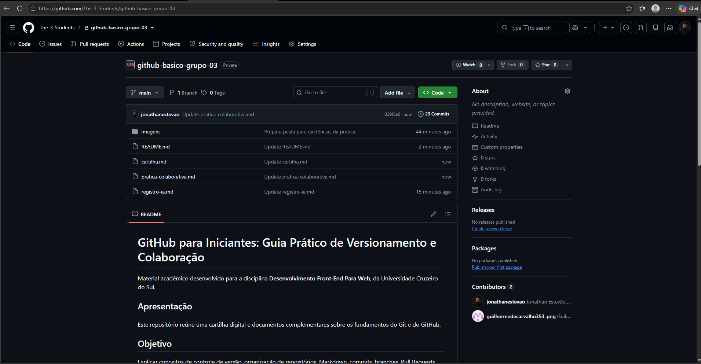
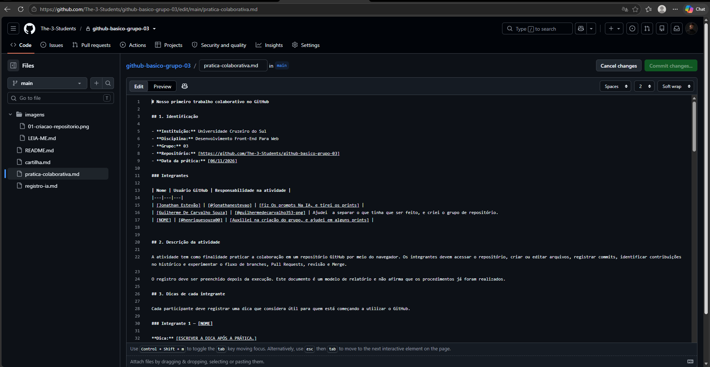
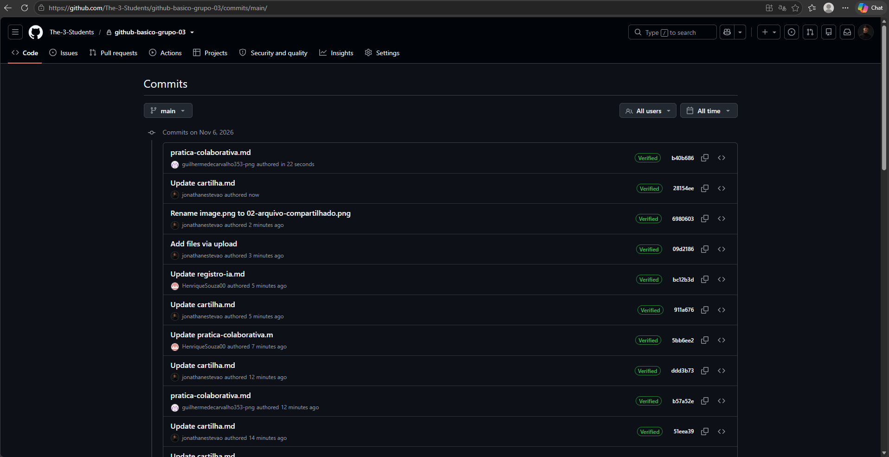
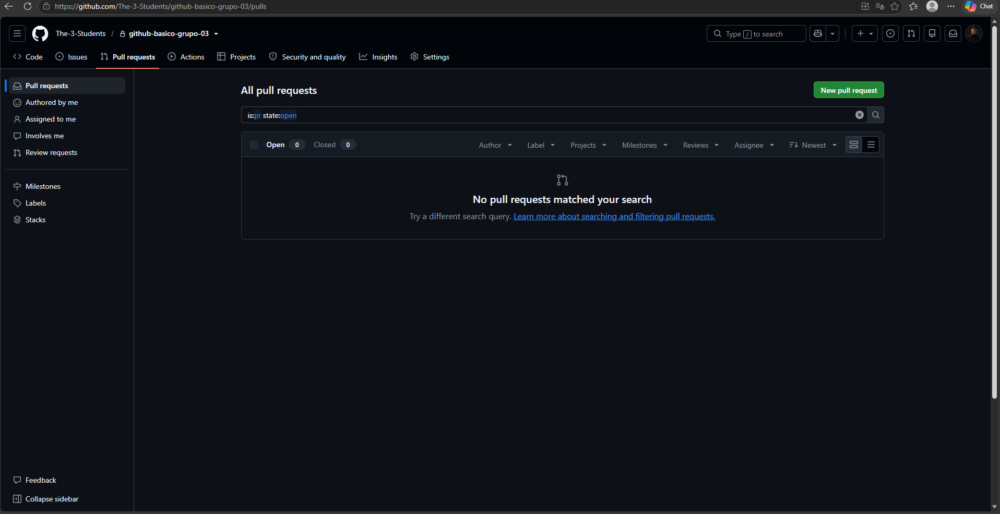
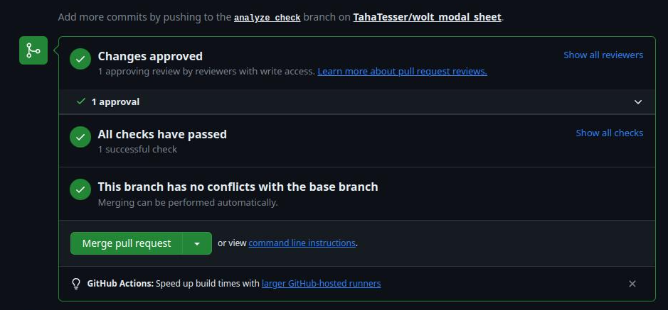

# Nosso primeiro trabalho colaborativo no GitHub

## 1. Identificação

- **Instituição:** Universidade Cruzeiro do Sul
- **Disciplina:** Desenvolvimento Front-End Para Web
- **Grupo:** 03
- **Repositório:** [https://github.com/The-3-Students/github-basico-grupo-03]
- **Data da prática:** [06/11/2026]

### Integrantes

| Nome | Usuário GitHub | Responsabilidade na atividade |
|---|---|---|
| [Jonathan Estevão] | [@jonathanestevao] | [PREENCHER] |
| [Guilherme De Carvalho Souza] | [@guilhermedecarvalho353-png] | [PREENCHER] |
| [NOME] | [@henriquesouza00] | [PREENCHER] |


## 2. Descrição da atividade

A atividade tem como finalidade praticar a colaboração em um repositório GitHub por meio do navegador. Os integrantes devem acessar o repositório, criar ou editar arquivos, registrar commits, identificar contribuições no histórico e experimentar o fluxo de branches, Pull Requests, revisão e Merge.

O registro deve ser preenchido depois da execução. Este documento é um modelo de relatório e não afirma que os procedimentos já foram realizados.

## 3. Dicas de cada integrante

Cada participante deve registrar uma dica que considera útil para quem está começando a utilizar o GitHub.

### Integrante 1 — [NOME]

**Dica:** [ESCREVER A DICA APÓS A PRÁTICA.]

**Por que essa dica é importante?** [EXPLICAR.]

### Integrante 2 — [NOME]

**Dica:** [ESCREVER A DICA APÓS A PRÁTICA.]

**Por que essa dica é importante?** [EXPLICAR.]

### Integrante 3 — [NOME]

**Dica:** [ESCREVER A DICA APÓS A PRÁTICA.]

**Por que essa dica é importante?** [EXPLICAR.]

[ADICIONE OU REMOVA SEÇÕES CONFORME A QUANTIDADE DE INTEGRANTES.]

## 4. Registro das contribuições

Preencher com base no histórico do repositório, nos arquivos alterados e nas atividades observadas.

| Integrante | Arquivo ou atividade | Contribuição realizada | Commit ou Pull Request relacionado |
|---|---|---|---|
| [NOME] | [ARQUIVO/ATIVIDADE] | [DESCREVER] | [LINK OU IDENTIFICADOR] |
| [NOME] | [ARQUIVO/ATIVIDADE] | [DESCREVER] | [LINK OU IDENTIFICADOR] |
| [NOME] | [ARQUIVO/ATIVIDADE] | [DESCREVER] | [LINK OU IDENTIFICADOR] |

## 5. Etapas executadas

Marque somente as atividades efetivamente concluídas.

- [ ] Todos os integrantes acessaram o repositório.
- [ ] Os convites necessários foram aceitos.
- [ ] Um arquivo foi criado ou editado pelo navegador.
- [ ] As alterações foram registradas em commits.
- [ ] O histórico foi consultado para identificar contribuições.
- [ ] Uma branch secundária foi criada.
- [ ] Um Pull Request foi aberto.
- [ ] Outro integrante revisou as alterações.
- [ ] O Merge foi realizado.
- [ ] O conteúdo foi conferido na branch principal.

## 6. Dificuldades encontradas

Registrar somente situações que realmente ocorreram. Se não houver dificuldades, informar isso.

| Situação observada | Integrante envolvido | Causa identificada | Solução adotada |
|---|---|---|---|
| [PREENCHER] | [NOME] | [PREENCHER] | [PREENCHER] |
| [PREENCHER] | [NOME] | [PREENCHER] | [PREENCHER] |

## 7. Perguntas de reflexão

As perguntas abaixo devem ser respondidas pelo grupo após a prática. Os campos foram deixados em aberto para evitar respostas inventadas.

### 1. Todos conseguiram acessar e editar o arquivo?

**Resposta do grupo:** [DESCREVER QUEM CONSEGUIU, SE HOUVE ALGUMA RESTRIÇÃO E COMO FOI RESOLVIDA.]

### 2. Como as mudanças chegaram aos colegas?

**Resposta do grupo:** [EXPLICAR COMO O GITHUB DISPONIBILIZOU AS ALTERAÇÕES NO REPOSITÓRIO, CONSIDERANDO COMMITS, BRANCHES E PULL REQUESTS UTILIZADOS.]

### 3. Como identificaram os autores das alterações?

**Resposta do grupo:** [DESCREVER COMO O HISTÓRICO DE COMMITS E AS INFORMAÇÕES DO PULL REQUEST FORAM CONSULTADOS.]

### 4. O que mudou após o Merge?

**Resposta do grupo:** [INFORMAR QUAIS ALTERAÇÕES FORAM INCORPORADAS À BRANCH DE DESTINO E COMO O RESULTADO FOI CONFERIDO.]

### 5. Qual problema foi resolvido?

**Resposta do grupo:** [RELATAR O PROBLEMA REALMENTE ENFRENTADO E A SOLUÇÃO. SE NÃO HOUVE PROBLEMA, REGISTRAR ISSO.]

## 8. Evidências e espaços para as capturas de tela

A atividade solicita pelo menos cinco capturas próprias, obtidas durante a execução das práticas. **As imagens ainda não foram inseridas neste modelo.** Coloque os arquivos PNG na pasta `imagens/`, usando exatamente os nomes indicados. Depois, substitua cada área reservada pelo respectivo recurso Markdown.

### Evidência 1 — Criação do repositório

> **ESPAÇO RESERVADO PARA A PRINT 01**
>
> **[INSERIR A CAPTURA REAL AQUI]**
>
> Arquivo: `imagens/01-criacao-repositorio.png`
>
> Mostrar: página do repositório do grupo, nome e estrutura inicial.
>
> Legenda sugerida: *Figura 1 — Criação e identificação do repositório do grupo.*

Código para inserir a imagem depois do envio:

```markdown

```

### Evidência 2 — Arquivo compartilhado e edição

> **ESPAÇO RESERVADO PARA A PRINT 02**
>
> **[INSERIR A CAPTURA REAL AQUI]**
>
> Arquivo: `imagens/02-arquivo-compartilhado.png`
>
> Mostrar: o arquivo coletivo aberto no GitHub e a dica ou contribuição adicionada por um integrante.
>
> Legenda sugerida: *Figura 2 — Edição do arquivo compartilhado pela interface web.*

Código para inserir a imagem depois do envio:

```markdown

```

### Evidência 3 — Histórico de commits

> **ESPAÇO RESERVADO PARA A PRINT 03**
>
> **[INSERIR A CAPTURA REAL AQUI]**
>
> Arquivo: `imagens/03-historico-commits.png`
>
> Mostrar: histórico com mensagens de commit e autores das contribuições.
>
> Legenda sugerida: *Figura 3 — Histórico de commits e identificação das contribuições.*

Código para inserir a imagem depois do envio:

```markdown

```

### Evidência 4 — Pull Request aberto

> **ESPAÇO RESERVADO PARA A PRINT 04**
>
> **[INSERIR A CAPTURA REAL AQUI]**
>
> Arquivo: `imagens/04-pull-request.png`
>
> Mostrar: Pull Request aberto, título, branches envolvidas e estado da revisão.
>
> Legenda sugerida: *Figura 4 — Pull Request submetido para revisão.*

Código para inserir a imagem depois do envio:

```markdown

```

### Evidência 5 — Resultado do Merge

> **ESPAÇO RESERVADO PARA A PRINT 05**
>
> **[INSERIR A CAPTURA REAL AQUI]**
>
> Arquivo: `imagens/05-resultado-merge.png`
>
> Mostrar: Pull Request marcado como mesclado e, se possível, a alteração visível na branch principal.
>
> Legenda sugerida: *Figura 5 — Alterações incorporadas à branch principal.*

Código para inserir a imagem depois do envio:

```markdown

```

**Cuidados ao capturar:** oculte e-mails, notificações particulares, dados de conta e qualquer informação sensível que não seja necessária para comprovar a atividade. Não altere a imagem de modo a modificar o sentido da evidência. Não use imagens fictícias ou capturas de terceiros como comprovação do grupo.


## 9. Conclusão da prática

[ELABORAR UM PARÁGRAFO COM O QUE O GRUPO APRENDEU, COMO FOI A DIVISÃO DAS TAREFAS E QUAL A IMPORTÂNCIA DO VERSIONAMENTO E DA REVISÃO COLABORATIVA.]
